# 03. Digital Features Specification & Architecture Blueprint

## 1. Core Platform Objectives

The web platform for **Future Vision Academy** (`futurevisionacademy.edu.bd`) must balance three core pillars:
1. **High-Converting Public Presence:** Attracting and converting prospective parents during the annual admission window (October–February).
2. **Operational Notice & Academic Hub:** Providing effortless access to daily notices, routines, academic calendars, and circulars for currently enrolled parents and students.
3. **Institutional Authority & Trust:** Showcasing facilities, faculty credentials, curriculum pathways, and contact/location details.

---

## 2. Information Architecture (Site Map)

```mermaid
graph TD
    A[Homepage] --> B[About Us]
    A --> C[Academics]
    A --> D[Admissions]
    A --> E[Notices]
    A --> F[Contact & Campus]
    
    B --> B1[Mission & Vision]
    B --> B2[Principal's Message]
    B --> B3[Faculty & Governance]
    B --> B4[Facilities & Campus Safety]
    
    C --> C1[Early Childhood / Kindergarten]
    C --> C2[Primary Section Class 1-5]
    C --> C3[Junior Secondary Class 6-8]
    C --> C4[Secondary SSC Science/Commerce/Arts]
    C --> C5[Co-Curriculars & Clubs]
    
    D --> D1[Admission Guidelines & Age Criteria]
    D --> D2[Digital Application Form]
    D --> D3[Fee Structure & Scholarship Policy]
    D --> D4[Application Status Tracker]
    
    E --> E1[Academic Circulars]
    E --> E2[Exam Routines & Results]
    E --> E3[Holiday & Urgent Alerts]
    
    F --> F1[Campus Map & Directions]
    F --> F2[Inquiry & Visiting Hours Form]
    F --> F3[Direct Phone / WhatsApp Links]
```

---

## 3. High-Priority Feature Modules

### Module 1: The Notice Engine
- **Why It Matters:** Most visited page on any school website in Bangladesh.
- **Specifications:**
  - Fast search by title or keywords.
  - Category tabs: `Academic`, `Admission`, `Administrative`, `Exam Routines`, `Urgent`.
  - Date stamping with an `Urgent` / `New` visual badge.
  - Single-click PDF download + inline modal preview (avoids unnecessary page leaves).

### Module 2: The Online Admissions Funnel
- **Step 1: Program Selection**
  - Select Grade (Playgroup to Class 10).
  - Version selection (Bangla Medium / English Version).
- **Step 2: Student & Guardian Profile**
  - Student Full Name (Bangla & English).
  - Date of Birth & Birth Registration Number (17-digit BRN).
  - Father & Mother Names, NIDs, Professions, and Primary Contact Number (with SMS capability).
- **Step 3: Document Attachments**
  - Student passport-size photo.
  - Birth certificate copy.
  - Previous school report card / TC (Transfer Certificate) if applying for Class 2+.
- **Step 4: Submission & Application Tracking Number**
  - Generates a unique tracking token (e.g. `FVA-2026-XXXX`).
  - Downloadable admission token / admit card PDF.
  - Optional MFS application fee gateway trigger (bKash/Nagad checkout).

### Module 3: Transparent Fee Schedule & Calculator
- Clear tabbed layout for:
  - Admission Fee & Session Charges (Once yearly).
  - Monthly Tuition Fees per grade.
  - Optional services: Transportation / School Bus, Daycare / After-school coaching, Lab fees.
- Note on payment channels: Online bKash Merchant, Nagad, and Over-the-counter designated bank branches.

### Module 4: Academic Calendar & Routines
- Term calendar: First Term, Mid-term, Annual Examinations, National Holidays (Pohela Boishakh, Eid, Independence Day, Victory Day).
- Downloadable class routines and syllabus outlines by grade.

### Module 5: Student Exam Results Portal (Phase 2)
- Form input: Student ID / Roll Number + Exam Selection (Term / Year).
- Secure digital marksheet preview displaying GPA, grade points, and subject breakdown.

---

## 4. Technical Stack & Architecture

- **Framework:** Next.js 16 (App Router) + React 19.
- **Styling Strategy:** CSS Modules / Pure CSS Custom Properties design system (`variables.css`, `layout.css`, `typography.css`) ensuring sub-second rendering without heavy UI runtime libraries.
- **Icons:** `lucide-react`.
- **SEO & Social Cards:**
  - Automated OpenGraph and Twitter cards in `layout.tsx`.
  - JSON-LD Schema markup for `EducationalOrganization` (name, address, telephone, EIIN, geo coordinates).
- **Hosting & CDN:** Vercel or cloud VPS with Bangladeshi edge routing, ensuring lightning-fast load times on local mobile operators (Grameenphone, Banglalink, Robi, Teletalk).
