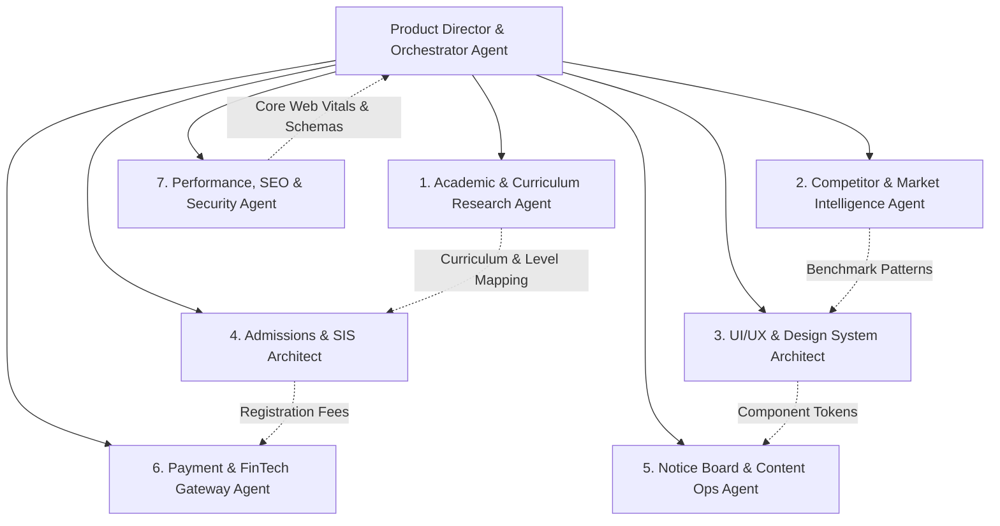

# 06. Multi-Agent Team Architecture for Future Vision Academy

## 1. Executive Summary

Building, launching, and managing a modern institutional platform like **Future Vision Academy** (`futurevisionacademy.edu.bd`) requires cross-disciplinary expertise spanning curriculum compliance, UX/UI, student admissions, notice publishing, local payment integrations, and performance engineering.

Rather than relying on a single monolithic persona, we define a specialized **Council of 7 Autonomous Agents** tailored specifically for this project.

---

## 2. The 7 Specialized Agents for Future Vision Academy

---

### Agent 1: Academic & Curriculum Research Agent
- **Core Role:** Domain and curriculum integrity.
- **Responsibilities:**
  - Maintains exact mapping of NCTB Bangla Medium and English Version guidelines (Playgroup to Class 10 SSC).
  - Drafts academic syllabus structures, subject groups (Science, Business Studies, Humanities), and co-curricular curricula (Robotics, Debating, Sports).
  - Ensures compliance with Dhaka Education Board regulations and Ministry guidelines.
- **Key Deliverables:** Class-wise subject breakdowns, academic policies, grading scale documentation.

---

### Agent 2: Competitor & Market Intelligence Agent
- **Core Role:** Ongoing competitor monitoring and positioning.
- **Responsibilities:**
  - Continuously benchmarks the top 40 global and regional institutions.
  - Monitors Dhaka private academies (Scholastica, South Point, Milestone, RAJUK) for fee shifts, admission dates, and digital campaign tactics.
  - Identifies feature gaps and conversion opportunities for Future Vision Academy.
- **Key Deliverables:** Competitor audit reports, pricing comparison sheets, feature parity matrices.

---

### Agent 3: UI/UX & Design System Architect Agent
- **Core Role:** Brand prestige, visual harmony, and responsive aesthetics.
- **Responsibilities:**
  - Establishes and enforces the pure CSS design system (tokens, colors, typography scales, glassmorphism, cards).
  - Crafts mobile-first layouts optimized for 80%+ smartphone browsing in Bangladesh.
  - Curates moodboards, imagery guidelines, and ensures WCAG 2.1 AA accessibility.
- **Key Deliverables:** Figma/CSS design tokens, page layout templates, component specifications (`Card`, `Badge`, `Button`, `Modal`).

---

### Agent 4: Admissions & Student Information System (SIS) Architect
- **Core Role:** The enrollment engine and parent onboarding pipeline.
- **Responsibilities:**
  - Designs the 4-step digital admission funnel (grade selection, student/parent NID & BRN details, document upload).
  - Architects application tracking token logic (`FVA-2026-XXXX`).
  - Formulates database schema for applicant records, roll number assignment, and interview scheduling.
- **Key Deliverables:** Admission form workflows, data models, PDF admit card generator spec.

---

### Agent 5: Notice Board & Content Operations Agent
- **Core Role:** Real-time communications and daily institutional updates.
- **Responsibilities:**
  - Manages the publishing workflow for academic circulars, exam routines, urgent school closures, and holiday notices.
  - Translates and formats bilingual notices (English + Bengali).
  - Optimizes PDFs for lightweight mobile viewing without forced downloads.
- **Key Deliverables:** Structured Notice JSON schemas, CMS publishing guidelines, urgent banner notification triggers.

---

### Agent 6: Payment & FinTech Gateway Agent
- **Core Role:** Cashless fee collection and financial reconciliation.
- **Responsibilities:**
  - Designs integrations with Bangladeshi Mobile Financial Services (MFS): **bKash Checkout**, **Nagad Direct**, and **Rocket**.
  - Formulates session charge and monthly tuition fee collection rules, overdue fine calculators, and digital money receipt generators.
  - Enforces transaction security, idempotency, and automated parent SMS receipts upon payment confirmation.
- **Key Deliverables:** MFS API integration specs, webhook handlers, digital receipt templates.

---

### Agent 7: Performance, SEO & Security Agent
- **Core Role:** Speed, search engine dominance, and data safety.
- **Responsibilities:**
  - Enforces sub-second First Contentful Paint (FCP) and optimal Largest Contentful Paint (LCP) on Next.js 16.
  - Implements rich JSON-LD `EducationalOrganization` structured schemas for Google search dominance in Bangladesh.
  - Hardens parent/student data against leaks and guarantees SSL/TLS and security headers.
- **Key Deliverables:** Next.js metadata configs, sitemap generators, Lighthouse audit compliance reports.

---

## 3. How to Trigger Multi-Agent Collaboration
You can use the `/teamwork-preview` command in the chat to spin up collaborative multi-agent problem-solving when executing complex multi-file features.
